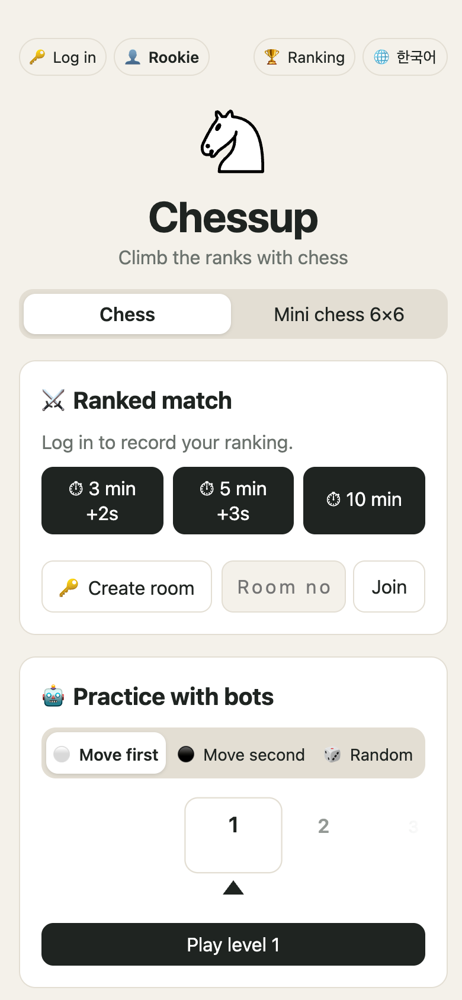
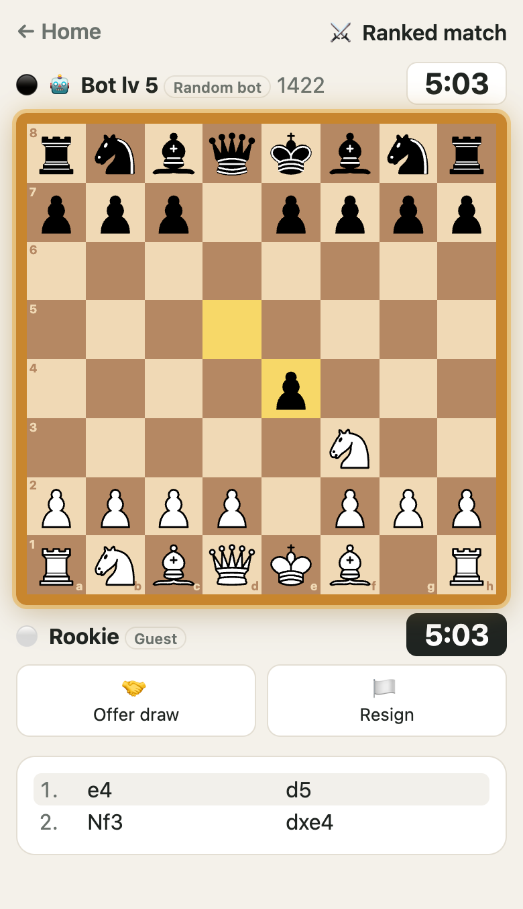
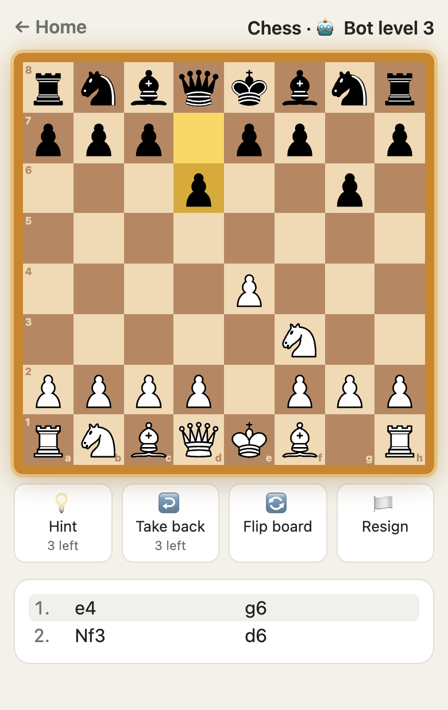

# ♟ Chessup

[한국어](README.md) · **English**

A web game for climbing the rankings in standard chess and mini chess (Los Alamos 6×6).

▶ **Play: https://chessup.lunchtime.workers.dev** — jump in as a guest, no sign-up needed.

<p>
  
  
  
</p>

## About

- **⚔️ Ranked match**: pick a time control (3 min +2s · 5 min +3s · 10 min) and get paired with someone near your rating. If nobody shows up within 15 seconds you play a **random bot** near your rating — or skip the wait with "🤖 Play a bot now".
- **🔑 Rooms**: give a friend a four-digit room number (or link) and the game starts as soon as they join.
- **🤖 Bot practice**: choose level 1–10 on a horizontal wheel and move first, move second or random. Levels you beat are marked ✓.
- **🏆 Leaderboard**: "This week" (points, guests included) and "All time" (rating, members).
- On your turn the **board frame glows gold** instead of showing "Your move" text.
- Korean and English, on phones and desktops.

## Rules

- Standard chess rules. Mini chess is Los Alamos chess on a 6×6 board (no bishops; no pawn double step, castling or en passant; no promotion to bishop).
- Members sign up with a username and password (no email or other personal data). Guests just pick a name before their first game.
- Members and guests share one queue; **only members keep a rating** (Glicko-2, separate for standard and mini; guests count as 1500). Games against the random bot are rated too (bot ratings run from 800 at level 1 to 2200 at level 10).
- The server keeps the clock. You can offer a draw or resign.
- The weekly ranking resets every Monday 00:00 KST (win 1 point, draw 0.5). Guests who sign up keep this week's results.
- In bot practice you get 3 hints and 3 take-backs per game. Levels won with help are marked 🤝; win again without help to clear the mark.

## Code map

| Path | What's there |
|---|---|
| `src/engine` | TypeScript chess engine (move generation, rules, notation, search), shared by client and server |
| `src/web` | Client (Vite) |
| `src/worker` | Cloudflare server (Hono · D1 · Durable Objects — one lobby, one room per game; the room also computes the random bot's moves) |
| `src/shared` | Message types shared by client and server |
| `server-java` | A second server following the same contract (Spring Boot · jOOQ · PostgreSQL · Flyway) — in progress |
| `docs/api.yaml` · `docs/schema.md` | Server contract (OpenAPI) and DB schema; every server implementation follows the same contract |
| `test` · `test-api` | Engine unit tests (perft etc.) · server contract tests (real requests against a running server) |

## Run

```sh
npm install
npx wrangler d1 migrations apply chessup --local
npm run worker:dev          # builds the client, then http://localhost:8787
npm test                    # engine and rating tests
API_BASE=http://localhost:8787 npm run test:api   # server contract tests
```

The Java server (`server-java`, Java 21 · Maven) needs Docker.

```sh
cd server-java
mvn test                                        # Testcontainers starts PostgreSQL for the tests
docker compose up -d && mvn -Pcodegen generate-sources   # only after schema changes: regenerate jOOQ code (:54329)
```

## Third-party

- Chess piece images (`public/piece`): [Cburnett](https://commons.wikimedia.org/wiki/User:Cburnett) (Wikimedia Commons) — 3-clause BSD License, full text in [`public/piece/LICENSE`](public/piece/LICENSE)
