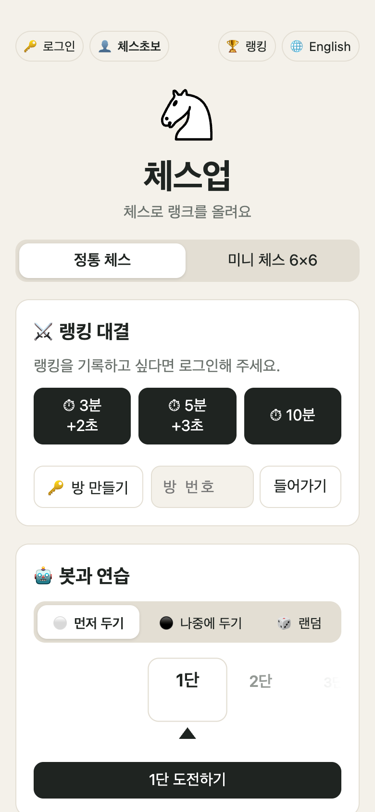
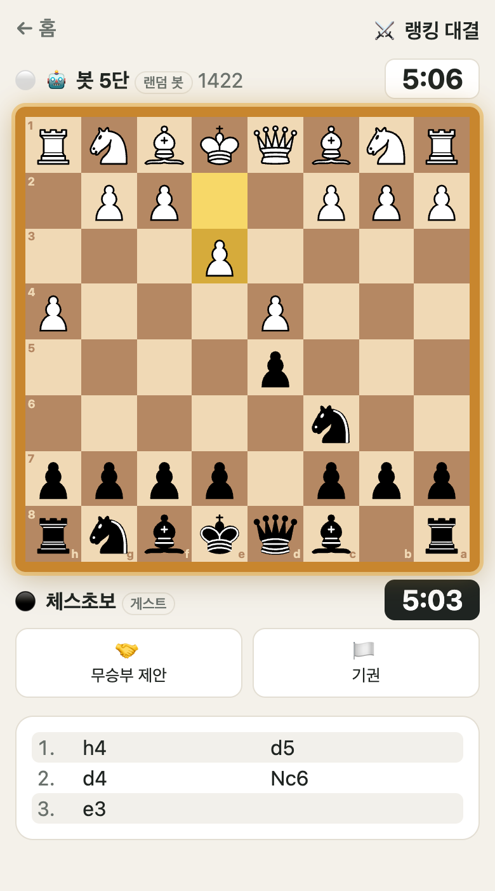
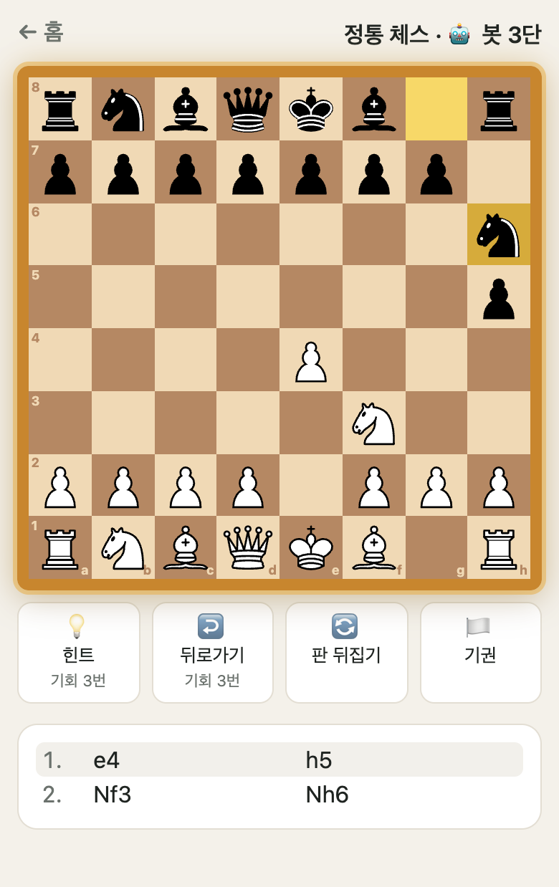

# ♟ 체스업 · Chessup

**한국어** · [English](README.en.md)

정통 체스와 미니 체스(로스앨러모스 6×6)로 랭킹을 올리는 웹 게임.

▶ **플레이: https://chessup.lunchtime.workers.dev** — 가입 없이 게스트로 바로 둘 수 있어요.

<p>
  
  
  
</p>

## 소개

- **⚔️ 랭킹 대결**: 시간(3분 +2초 · 5분 +3초 · 10분)을 고르면 비슷한 레이팅의 상대와 짝지어 줍니다. 15초 안에 상대가 없으면 내 레이팅 근처의 **랜덤 봇**과 두고, 기다리지 않고 「🤖 봇과 바로 두기」를 눌러도 됩니다.
- **🔑 방 만들기**: 숫자 네 자리 방 번호(또는 링크)를 친구에게 주면, 친구가 들어오는 즉시 대결이 시작됩니다.
- **🤖 봇과 연습**: 가로 휠로 1단~10단을 고르고, 먼저 두기 · 나중에 두기 · 랜덤 중 하나로 둡니다. 깬 단계는 ✓ 로 남습니다.
- **🏆 랭킹**: 「이번 주」(승점 · 게스트 포함)와 「전체」(레이팅 · 회원).
- 내 차례에는 「내 차례」 글자 대신 **판 테두리가 금빛으로 빛납니다**.
- 한국어 · 영어, 폰 · 컴퓨터 모두 지원합니다.

## 규칙

- 체스 규칙은 일반 체스와 같습니다. 미니 체스는 6×6 로스앨러모스 체스입니다(비숍 없음 · 폰 두 칸 전진·캐슬링·앙파상 없음 · 비숍으로 승진 없음).
- 회원은 아이디 + 비밀번호로 가입합니다(이메일 등 개인정보는 받지 않음). 게스트는 처음 둘 때 이름만 정합니다.
- 회원과 게스트가 한 줄에서 만나고, **레이팅은 회원만** 쌓입니다(Glicko-2 · 정통·미니 따로 · 게스트는 1500으로 셈). 랜덤 봇과의 대결도 레이팅에 반영됩니다(봇 레이팅 1단 800 ~ 10단 2200).
- 시계는 서버가 잽니다. 무승부 제안 · 기권이 있습니다.
- 이번 주 랭킹은 한국 시각 월요일 0시에 새로 시작합니다(승 1점 · 무 0.5점). 게스트가 가입하면 이번 주 결과를 이어받습니다.
- 봇 연습에서는 힌트와 뒤로가기를 한 판에 3번씩 쓸 수 있습니다. 쓰고 이긴 단계는 🤝 표시가 붙고, 도움 없이 다시 깨면 사라집니다.

## 구조

| 경로 | 내용 |
|---|---|
| `src/engine` | TypeScript 체스 엔진(수 생성·판정·기보·탐색) — 화면과 서버가 함께 씀 |
| `src/web` | 화면(Vite) |
| `src/worker` | Cloudflare 서버(Hono · D1 · Durable Objects — 로비 하나, 대결마다 방 하나 · 랜덤 봇 수도 대결 방이 계산) |
| `src/shared` | 화면·서버가 주고받는 글의 타입 |
| `server-java` | 같은 약속을 따르는 두 번째 서버(Spring Boot · jOOQ · PostgreSQL · Flyway) — 만드는 중 |
| `docs/api.yaml` · `docs/schema.md` | 서버 약속(OpenAPI)과 DB 구조 — 서버 구현이 여럿이어도 같은 약속을 따름 |
| `test` · `test-api` | 엔진 단위 시험(perft 등) · 서버 약속 시험(돌고 있는 서버에 실제 요청) |

## 실행

```sh
npm install
npx wrangler d1 migrations apply chessup --local
npm run worker:dev          # 화면 빌드 후 http://localhost:8787
npm test                    # 엔진·레이팅 시험
API_BASE=http://localhost:8787 npm run test:api   # 서버 약속 시험
```

Java 서버(`server-java`, Java 21 · Maven)는 Docker 가 있어야 합니다.

```sh
cd server-java
mvn test                                        # Testcontainers 가 PostgreSQL 을 띄워 시험
docker compose up -d && mvn -Pcodegen generate-sources   # 표를 바꿨을 때만: jOOQ 코드 다시 생성(:54329)
```

## 빌려 쓴 것

- 체스 말 그림(`public/piece`): [Cburnett](https://commons.wikimedia.org/wiki/User:Cburnett) (Wikimedia Commons) — 3조항 BSD 라이선스, 전문은 [`public/piece/LICENSE`](public/piece/LICENSE)
